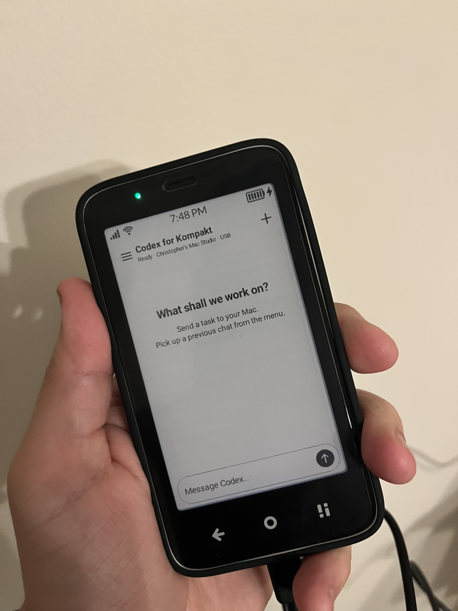
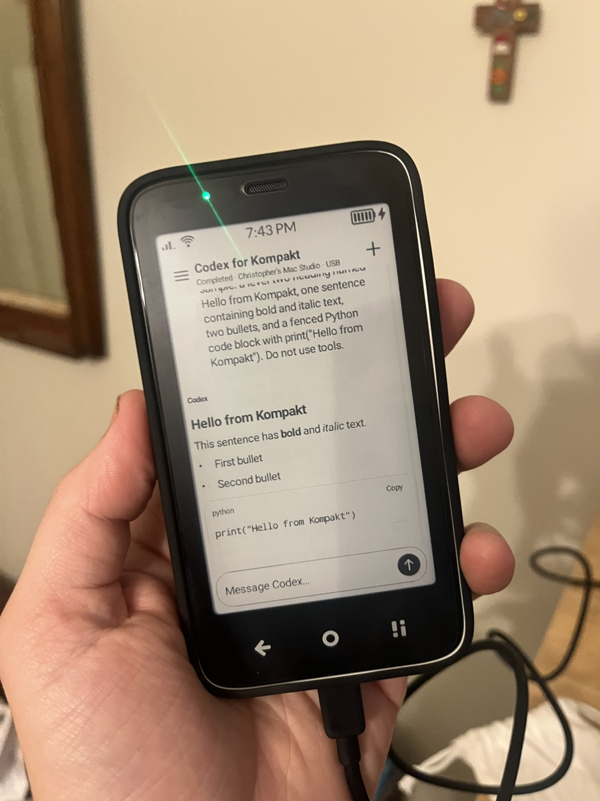
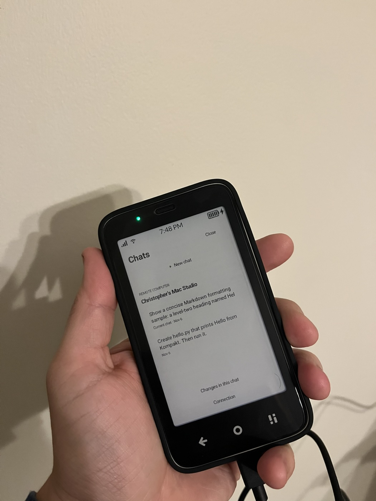
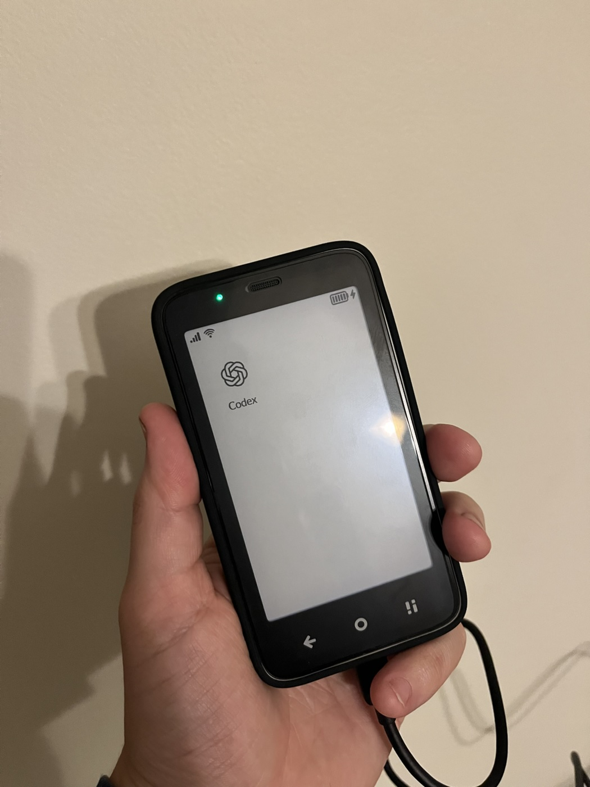

# Codex for Kompakt

A small native Android client that lets a **Mudita Kompakt** run coding tasks on a Mac through the Codex app-server, review results, and approve actions from the phone.

This is an independent personal prototype, not an official OpenAI or Mudita app. The Android app is named **Codex**; its header reads **Codex for Kompakt**. It connects to a locally installed Codex harness instead of running a language model on the phone.

## On the Kompakt

Photos of the working prototype on the physical phone, connected to the Mac over USB.

<table>
  <tr>
    <td align="center"><br>Start a task</td>
    <td align="center"><br>Read Markdown and code</td>
  </tr>
  <tr>
    <td align="center"><br>Return to previous chats</td>
    <td align="center"><br>A single app on the launcher</td>
  </tr>
</table>

## Status

Version **0.2.0** has been built, sideloaded, and tested on a Kompakt running MuditaOS K 1.1.1 / Android 12 (API 31), with a 480 × 800 display and approximately 3 GB RAM. The development APK was about **0.59 MB**, including its icon and Markdown parser. A foreground measurement showed approximately **43 MiB PSS**.

**USB only today.** The Mac companion listens on `127.0.0.1:39443`, and ADB reverse carries the phone's HTTPS connection to it. Wi-Fi, cellular access, and background notifications are not implemented. The Mac must remain awake, online, and running the companion.

## Features

- Send coding tasks and follow-up messages using the Mac's existing Codex sign-in.
- Review individual requests and explicitly approve or deny them. Approval controls remain visible while long commands scroll.
- Answer structured questions and stop an active task.
- Browse saved chats under the paired computer's name, resume their context, and rename them with a long press.
- Read Markdown headings, bold/italic text, lists, quotes, inline code, and code boxes with Copy.
- Use an e-ink-friendly interface with a chat drawer, rounded composer, send arrow, stop control, and expandable command details.
- View diffs when emitted by Codex; shell-created files do not always produce a diff event.

The companion manages its own conversations in one configured project. It does not import the desktop app's conversations or cloud tasks. Markdown is rendered with CommonMark into native Android controls, not OpenAI's proprietary renderer; tables and syntax coloring are not implemented.

## Architecture

```text
Kompakt: native Java UI
    │ HTTPS + pinned host certificate + pairing credential
    │ ADB reverse over USB
Mac: Python standard-library companion (localhost)
    │ JSON-RPC over stdio
Mac: Codex app-server → selected project
```

The phone holds a revocable companion credential, not the user's OpenAI credentials. Codex authentication stays on the Mac. The implementation was tested against `codex-cli 0.166.0-alpha.6`; revalidate the app-server protocol when upgrading.

## Build

Requirements: macOS with Python 3.9+, OpenSSL, a signed-in Codex installation, an authorized USB-debugging connection to the phone, and the following local toolchain. The recorded archives and checksums are in [`toolchain.lock.json`](toolchain.lock.json); the original build used Apple Silicon macOS.

```text
work/toolchain/
  jdk/jdk-17.0.21+9/Contents/Home/       # Temurin JDK 17
  sdk-platform/android-35/android.jar  # Android API 35
  sdk-build/android-15/                # Android Build Tools 35.0.0
  android/platform-tools/adb          # Android platform-tools
```

Download and extract the archives into this layout. No Gradle, Google services, or WebView is required. CommonMark Java 0.22.0 is included under `android/libs`; its checksum and license are recorded in [`dependencies.lock.json`](dependencies.lock.json).

From the repository root:

```sh
python3 build.py \
  --toolchain work/toolchain \
  --work work/android-build \
  --output dist/Codex.apk

PYTHONDONTWRITEBYTECODE=1 python3 -m unittest -v test_companion
```

Keep `work/android-build/development.keystore` private and retain it to sign compatible updates. Generated APKs and keys are ignored by Git.

## Pair and run

1. Enable USB debugging on the Kompakt and authorize your Mac when prompted.
2. Confirm that `work/toolchain/android/platform-tools/adb devices` lists the phone as authorized.
3. Install the APK and provision a fresh local pairing credential:

   ```sh
   python3 setup_pairing.py \
     --runtime work/kompakt-runtime \
     --adb work/toolchain/android/platform-tools/adb \
     --apk dist/Codex.apk
   ```

4. Start the companion, pointing it at the project you want to work on:

   ```sh
   KOMPAKT_WORKSPACE=/absolute/path/to/your/project \
     './Start USB Companion.command'
   ```

   The helper finds `codex` on `PATH`, then checks the desktop app's bundled location. Set `KOMPAKT_CODEX=/absolute/path/to/codex` if necessary. `KOMPAKT_ADB` and `KOMPAKT_RUNTIME` can also override the defaults. Without a workspace override, it uses `work/demo-project`.

5. Open **Codex** on the phone. Enter a task and tap the up arrow. When requested, tap **Approve or deny**, inspect the action, and select **Approve once** or **Deny**.

Keep the companion's Terminal window open; Control-C stops it. After reconnecting the cable, run `./Reconnect\ Phone.command`. A Mac reboot requires restarting the companion. Use the three-bar menu for previous chats and **+** for a new chat. Finish or stop the current task before switching chats.

Do not enable the pairing script's optional Wi-Fi setting without separately implementing and testing a restricted listener and access policy. It does not provide remote networking by itself.

## Credentials and approvals

The companion uses Codex's read-only sandbox with approval on request. It never automatically approves actions, never grants a session-wide approval, and rejects expired or previously answered request IDs. Pending actions are not replayed after a restart. Check the project before retrying an interrupted task.

TLS hostname verification remains enabled. The phone trusts its provisioned host certificate. Unauthenticated requests and browser-origin requests are rejected. Pairing transfers the credential through ADB standard input rather than a command-line argument. Runtime credentials and chat history live in the ignored `work/kompakt-runtime` directory and the phone's private app storage.

The APK is a **debuggable development build** to permit USB provisioning through `run-as`; Android backup is disabled. A general release needs release signing, a production pairing flow, and further testing. No pre-paired APK, signing key, account credential, or personal chat history is included in this repository.

To revoke a phone, stop the companion, replace the pairing token, and pair only devices you still trust. The setup script preserves an existing token, so rotation must be explicit. Local TLS certificates currently expire after one year and must then be regenerated and re-paired.

## Validation

- A phone-submitted task created `hello.py`, received three real approvals on the phone, and printed `Hello from Kompakt` on the Mac.
- Saved chats reopened from the phone's drawer; a live follow-up confirmed resumed conversation context.
- Markdown layout was visually checked on the physical e-ink display.
- Fourteen unit tests cover task deduplication, busy guards, approval decisions and expiry, restart behavior, saved-chat persistence, and renaming.
- The companion was restarted and both saved chats remained available.

[`verification.json`](verification.json) records the prototype measurements. These are spot checks, not battery or performance benchmarks.

## Local dictation

Not implemented yet. Local Whisper looks feasible on memory: upstream [whisper.cpp](https://github.com/ggml-org/whisper.cpp#memory-usage) lists tiny at 75 MiB on disk and approximately 273 MB memory. Actual latency, Android memory use, battery use, and coding vocabulary accuracy still need measurement on the Kompakt.

The proposed first version uses `tiny.en` or multilingual `tiny` through an ARM64 NDK/JNI build: record 15–30 seconds, stop, transcribe locally, edit in the composer, then explicitly send. Audio would stay on the phone and be discarded after transcription or cancellation. No Whisper model is bundled in 0.2.

## Next steps

- Private Wi-Fi/cellular connectivity and pairing.
- Local dictation benchmarking and integration.
- Multiple computers and projects; desktop/cloud history integration.
- Release signing, background notifications, automatic Mac startup, and battery testing.
- Chat deletion and retention controls. Currently the companion keeps up to 100 message entries per chat, with bounded message and diff sizes.

The phone polls every two seconds only while foregrounded. An app-server disconnect currently requires restarting the companion.

See [`THIRD_PARTY_NOTICES.md`](THIRD_PARTY_NOTICES.md) for dependency and artwork attribution.
